# SUGA — Brownout Notifier

SUGA is a Flutter mobile application that helps users monitor scheduled power interruptions, check affected areas, and receive notifications about brownout advisories. It uses a REST API built with Node.js and Express, with a SQLite-compatible database powered by libSQL.

## Table of Contents

- [Features](#features)
- [Screenshots](#screenshots)
- [Technology Stack](#technology-stack)
- [Project Structure](#project-structure)
- [Architecture](#architecture)
- [Requirements](#requirements)
- [Getting Started](#getting-started)
- [API Overview](#api-overview)
- [Configuration](#configuration)
- [Testing](#testing)
- [Release Build](#release-build)
- [Debugging and Performance](#debugging-and-performance)
- [Known Limitations](#known-limitations)
- [Development Team](#development-team)
- [Contributing](#contributing)
- [License](#license)

## Features

### User Features

- **Dashboard:** View brownout information and interruption status.
- **Areas:** Browse and search service areas.
- **Area Details:** View area information, affected feeders, and current or scheduled interruptions.
- **Scheduled Brownouts:** Browse scheduled power interruption advisories.
- **Brownout Details:** View advisory information, including dates, times, affected areas, feeders, and estimated restoration when available.
- **Notifications:** View notification information and manage notification preferences.
- **Local Reminders:** Schedule local notifications for upcoming advisories, subject to device permissions and notification configuration.
- **Saved Areas:** Save areas for easier access.

### Administrator Features

- **Admin Login:** Authenticate using a configured administrator account.
- **Advisory Management:** Create, view, update, and delete brownout advisories.
- **Status Management:** Manage advisory information and statuses.
- **Search, Filter, and Sort:** Find advisories using the available administrative list controls.
- **Area and Feeder Associations:** Associate advisories with affected areas and their feeders.

Administrator write operations are protected by API authorization. Administrator accounts are managed separately; the application does not provide public administrator registration.

## Screenshots

The following screenshots illustrate the application's user and administrator interfaces.

### User Interface

| Screen | Screenshot |
|---|---|
| Home | 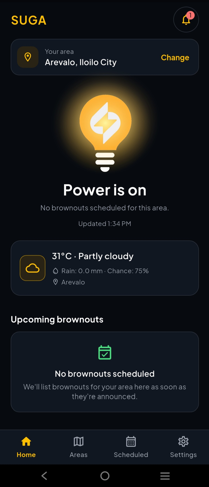 |
| Areas | 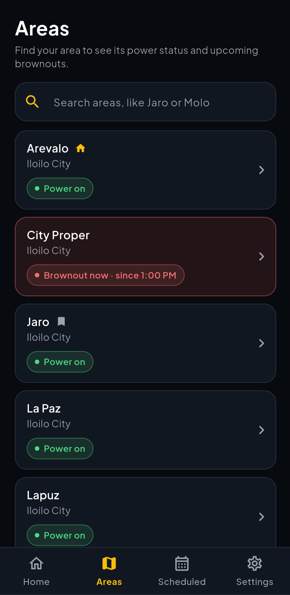 |
| Area Details — Current Outage | 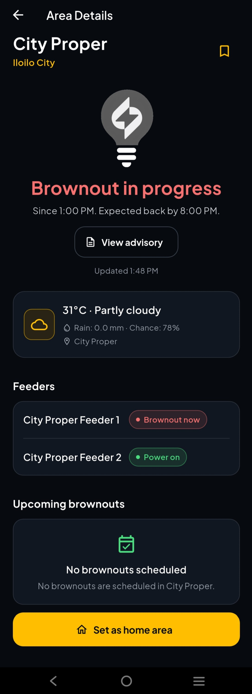 |
| Area Details — Scheduled | 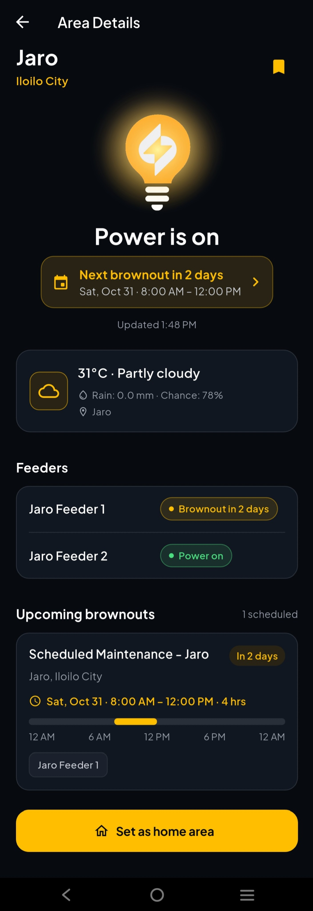 |
| Scheduled Brownouts | 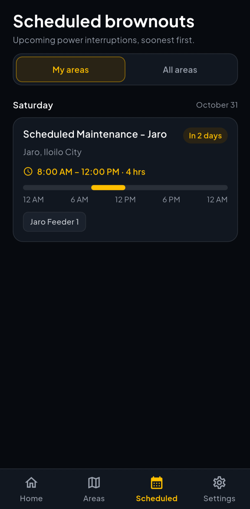 |
| Brownout Details | 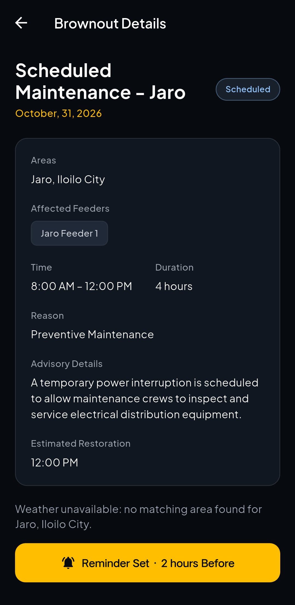 |
| Notifications | 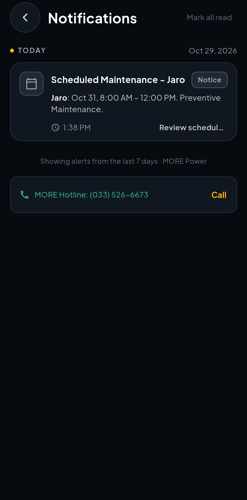 |
| Settings | 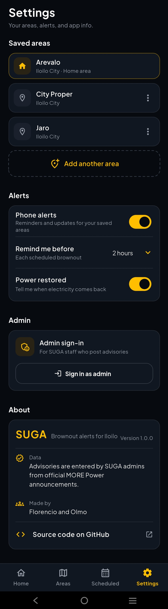 |

### Administrator Interface

| Screen | Screenshot |
|---|---|
| Admin Login | 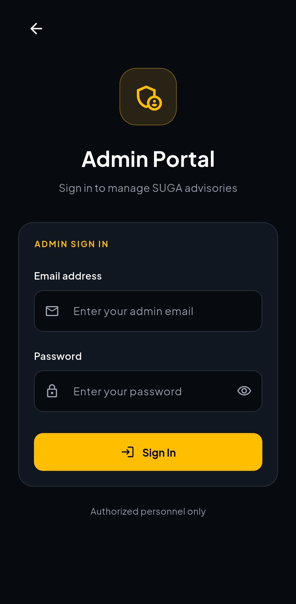 |
| Admin Scheduled Brownouts | 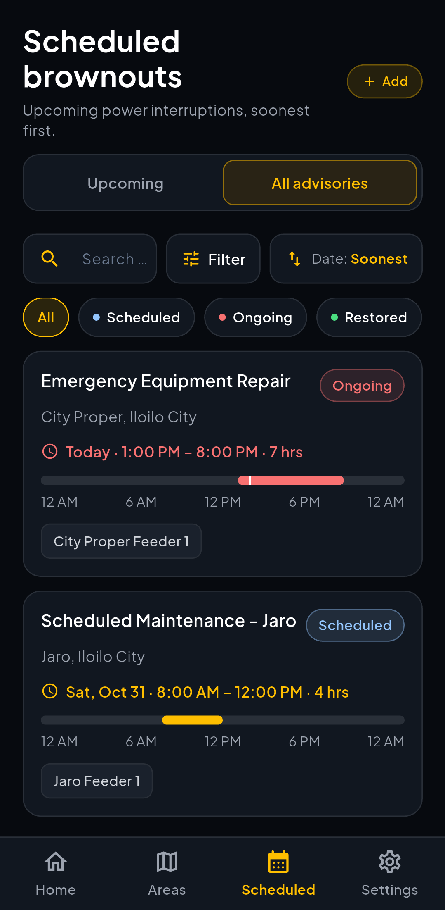 |
| Admin Brownout Details | 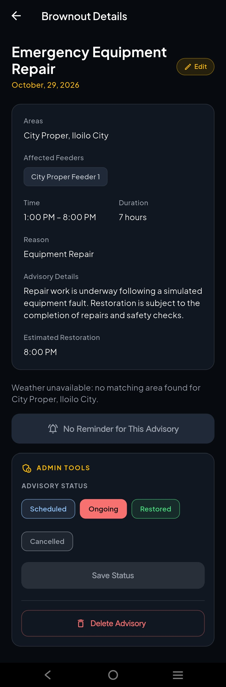 |
| Add Brownout Advisory | 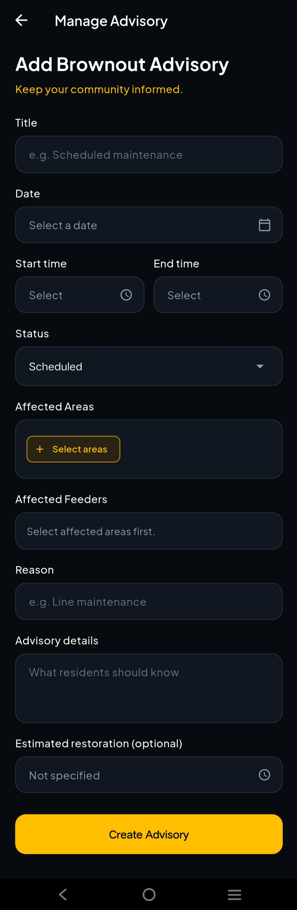 |
| Edit Brownout Advisory | 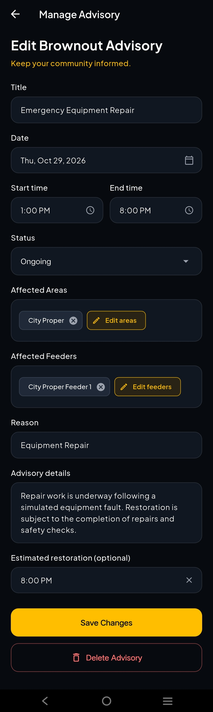 |

## Technology Stack

| Component | Technologies |
|---|---|
| Mobile application | Flutter, Dart |
| State management | Provider, `ChangeNotifier` |
| API communication | `http`, JSON, REST |
| Date and time formatting | `intl` |
| Local notifications | `flutter_local_notifications`, `timezone` |
| Local preferences | `shared_preferences` |
| Secure local storage | `flutter_secure_storage` |
| Additional UI and navigation utilities | `flutter_svg`, `url_launcher`, `cupertino_icons` |
| Backend runtime | Node.js 18 or later |
| Backend framework | Express |
| Database client | `@libsql/client` |
| Environment configuration | `dotenv` |
| Flutter testing and linting | `flutter_test`, `flutter_lints` |

## Project Structure

```text
FP_SUGA/
├── android/                    # Android application
├── assets/
│   ├── fonts/                  # Application fonts
│   └── images/                 # Application images
├── backend/
│   ├── data/                   # Local development database
│   ├── src/
│   │   ├── auth/               # Authentication utilities
│   │   ├── db/                 # Database migration, seed, and verification
│   │   ├── middleware/          # Request handling and authorization
│   │   ├── repositories/        # Database access
│   │   ├── routes/              # API endpoints
│   │   └── validation/          # Request validation
│   ├── .env.example            # Backend environment template
│   └── package.json
├── docs/
│   ├── screenshots/             # Application screenshots
│   ├── RELEASE.md               # Release and submission checklist
│   └── devtools-debugging.md    # Debugging review and DevTools checklist
├── lib/
│   ├── models/                  # Data models
│   ├── providers/               # Provider state management
│   ├── routes/                  # Named application routes
│   ├── screens/                 # Application screens
│   ├── services/                # API and other services
│   ├── theme/                   # Theme and styling
│   ├── utils/                   # Shared utilities
│   └── widgets/                 # Reusable UI components
├── test/                        # Flutter tests
├── web/                         # Web application support
├── windows/                     # Windows application support
├── linux/                       # Linux application support
├── macos/                       # macOS application support
├── ios/                         # iOS application
├── pubspec.yaml
└── README.md
```

## Architecture

### Flutter Application

The application uses Provider for state management and separates its responsibilities across models, providers, screens, and services.

- **Models:** Represent application data, including areas and power interruptions.
- **Providers:** Manage application state and notify dependent widgets when data changes.
- **Screens:** Present the dashboard, areas, advisory details, notifications, settings, and administrator interfaces.
- **Services:** Handle communication with the backend and other application services.
- **Routes:** Manage named navigation between screens.

### Backend

The backend is an Express REST API with separated routing, validation, authentication, middleware, and repository layers.

- **Routes:** Expose authentication, area, and interruption endpoints.
- **Validation:** Validate request parameters and payloads before database operations.
- **Authentication and authorization:** Protect administrator sessions and restricted operations.
- **Repositories:** Handle database access.
- **Database utilities:** Support schema migrations, sample-data seeding, and verification.

### Database

The backend supports a local development database through a SQLite-compatible libSQL database and can be configured to use a hosted Turso database.

Seeded advisories are development sample data. They must not be represented as official utility announcements without confirmation from a reliable source.

## Requirements

Install the following before setting up the project:

- Flutter SDK compatible with the project's Dart SDK constraint (`^3.12.2`).
- Dart SDK supplied with Flutter.
- Node.js 18 or later and npm.
- Android Studio or another supported Flutter development environment.
- An Android emulator or a physical Android device for mobile testing.

For device-specific Flutter setup, consult the [Flutter installation documentation](https://docs.flutter.dev/get-started/install).

## Getting Started

### 1. Clone the Repository

```bash
git clone https://github.com/Not-PvP/FP_SUGA.git
cd FP_SUGA
```

### 2. Set Up the Backend

Open a terminal in the `backend/` directory:

```bash
cd backend
npm install
```

Create a local environment file by copying the example.

PowerShell:

```powershell
Copy-Item .env.example .env
```

macOS/Linux:

```bash
cp .env.example .env
```

The default development configuration uses a local database:

```env
DATABASE_URL=file:./data/suga.db
DATABASE_AUTH_TOKEN=
PORT=3000
ADMIN_API_KEY=change-me
```

Keep `.env` private. Do not commit database credentials, API keys, administrator passwords, or other secrets.

Run the database migration and seed commands:

```bash
npm run db:migrate
npm run db:seed
npm run db:verify
```

These commands initialize the schema, add seed data where appropriate, and verify database operations. The seed script adds sample advisories only when the interruption table is empty.

**Important:** `npm run db:reset` is destructive. It resets the database before seeding it and should not be used on a database containing data you need to preserve.

### 3. Create an Administrator Account

The backend provides an administrator creation command:

```bash
npm run admin:create -- --email admin@example.com --password "replace-with-a-strong-password" --name "SUGA Admin"
```

Replace the example email and password with your own values. Do not commit real credentials.

The backend also supports administrator configuration through environment variables where applicable. Refer to `backend/README.md` for the full backend setup and deployment instructions.

### 4. Start the Backend

From the `backend/` directory:

```bash
npm run dev
```

The API uses port `3000` by default.

Check that the server responds using:

```text
http://localhost:3000/api/health
```

A successful health check returns a JSON response indicating that the API is running.

### 5. Set Up the Flutter Application

Open a separate terminal at the repository root:

```bash
flutter pub get
flutter analyze
flutter test
```

### 6. Run the Application

For the Android emulator, the API base URL defaults to:

```text
http://10.0.2.2:3000
```

Run the application:

```bash
flutter run
```

The API base URL can be overridden at build or run time:

```bash
flutter run --dart-define=API_BASE_URL=http://10.0.2.2:3000
```

Use the appropriate URL for your device and network configuration.

## Configuration

### API Base URL

The Flutter application reads `API_BASE_URL` through a Dart compile-time environment variable.

```bash
flutter run --dart-define=API_BASE_URL=http://10.0.2.2:3000
```

The default URL depends on the target platform:

| Target | Default API URL |
|---|---|
| Android emulator | `http://10.0.2.2:3000` |
| Other platforms, including web | `http://localhost:3000` |

A physical phone cannot normally reach the development computer through the Android emulator's `10.0.2.2` address.

For a physical Android device, choose one of these configurations:

**Option A — Use the computer's LAN IP address**

Ensure the phone and computer are on the same network, the backend listens on an address reachable from the phone, and the firewall permits the connection.

```bash
flutter run --dart-define=API_BASE_URL=http://YOUR-COMPUTER-LAN-IP:3000
```

Replace `YOUR-COMPUTER-LAN-IP` with the computer's actual local network IP address.

**Option B — Use ADB reverse port forwarding**

With the phone connected through USB debugging, run:

```bash
adb reverse tcp:3000 tcp:3000
flutter run --dart-define=API_BASE_URL=http://localhost:3000
```

ADB reverse forwards the phone's local port to the computer's port. The override is important because the Flutter code's default Android URL is `10.0.2.2`.

For a release APK, configure the API URL to point to a backend reachable by the installed phone. Do not ship a release app configured to use an inaccessible development address.

### Administrator API Key

The backend's `.env` file contains the `ADMIN_API_KEY` configuration used to authorize protected administrative API operations. The application also supports authenticated administrator sessions using bearer tokens.

Keep administrator secrets out of source control. Use secure, environment-specific values and follow the backend documentation when configuring deployment.

## API Overview

The API is mounted under `/api`.

### Health and Authentication

| Method | Endpoint | Purpose | Access |
|---|---|---|---|
| GET | `/api/health` | Check whether the API is running | Public |
| POST | `/api/auth/login` | Sign in as an administrator | Public |
| GET | `/api/auth/me` | Get the current administrator session | Authenticated session |
| POST | `/api/auth/logout` | End the current administrator session | Authenticated session |

### Areas

| Method | Endpoint | Purpose | Access |
|---|---|---|---|
| GET | `/api/areas` | List areas; supports documented search and filtering query parameters | Public |
| GET | `/api/areas/:id` | Get area details and associated feeders | Public |
| POST | `/api/areas` | Create an area | Administrator |
| PATCH | `/api/areas/:id` | Update an area | Administrator |
| DELETE | `/api/areas/:id` | Delete an area | Administrator |

### Power Interruptions

| Method | Endpoint | Purpose | Access |
|---|---|---|---|
| GET | `/api/interruptions` | List interruption advisories; supports documented filters | Public |
| GET | `/api/interruptions/:id` | Get interruption details | Public |
| POST | `/api/interruptions` | Create an interruption advisory | Administrator |
| PATCH | `/api/interruptions/:id` | Update an interruption advisory | Administrator |
| DELETE | `/api/interruptions/:id` | Delete an interruption advisory | Administrator |

Successful responses generally use a JSON envelope with `success: true` and a `data` field. List responses also include `count`, which indicates the number of returned records.

Example list response:

```json
{
  "success": true,
  "count": 1,
  "data": [
    {
      "id": 1
    }
  ]
}
```

Error responses use a consistent envelope:

```json
{
  "success": false,
  "error": {
    "code": "VALIDATION_ERROR",
    "message": "The request is invalid.",
    "details": {}
  }
}
```

The `details` field is included when additional error information is available. Successful create operations return HTTP `201`; successful delete and logout operations return HTTP `204` with no response body.

For exact validation rules, query parameters, and request payloads, consult the route and validation files under `backend/src/`.

## Testing

Run the Flutter checks from the repository root:

```bash
flutter analyze
flutter test
```

Run backend checks from `backend/`:

```bash
npm run db:verify
npm run test:api
```

### Verification Results

The following checks were run during this README audit:

| Check | Result |
|---|---|
| `flutter analyze` | Passed; no issues reported |
| `flutter test` | Passed; all tests passed |
| `npm run db:verify` | Passed; all database checks passed |
| `npm run test:api` | Passed; all reported API checks passed |

The API test script starts a temporary server and uses the configured database to test authentication, authorization, area and interruption endpoints, request validation, error handling, and CORS. It creates temporary test records and contains cleanup logic. Run it against a development database, not a production database.

These results describe the checks run during this audit; they do not imply that every feature has been tested on every device or under every deployment configuration.

## Release Build

To build an Android release APK:

```bash
flutter build apk --release --dart-define=API_BASE_URL=https://YOUR-DEPLOYED-API
```

Replace `https://YOUR-DEPLOYED-API` with the actual base URL of the deployed backend, without adding `/api` if the client already appends that path.

The APK is normally generated at:

```text
build/app/outputs/flutter-apk/app-release.apk
```

Install and test the APK on a physical device. Verify that the API is reachable, areas and advisories load correctly, administrator login works, and notification permissions and reminders behave as expected.

For signing, versioning, installation, and the submission checklist, see [`docs/RELEASE.md`](docs/RELEASE.md).

## Debugging and Performance

The project includes [`docs/devtools-debugging.md`](docs/devtools-debugging.md), which documents a static code review and a performance-related fix.

The review identified repeated API requests caused by creating a `Future` inside the brownout details screen's `build()` method. The future was moved into `_AdvisoryWeatherState` so it is created once instead of being recreated on every rebuild.

The documentation also contains a Flutter DevTools checklist for examining network requests, widget rebuilds, frame performance, memory behavior, and error handling.

**Status:** The static review and code fix are documented. The DevTools runtime checklist still needs to be completed with actual observations and screenshots before claiming that the runtime performance investigation has been fully verified.

## Known Limitations

- **Sample data:** Seeded advisories and development data are for testing and are not official utility announcements.
- **Backend availability:** The application needs a reachable backend to retrieve current server data. Offline behavior depends on the app's implemented caching and error-handling paths.
- **Notifications:** Local reminders depend on device permissions, operating-system behavior, and the app's notification configuration. SMS functionality should not be considered available unless separately implemented and verified.
- **DevTools evidence:** The static code review is documented, but the runtime DevTools checklist still needs evidence from a device or emulator.
- **Large administrator lists:** The documented static review notes that the administrator's all-advisories list builds rows eagerly. A lazy list may be preferable if the number of advisories grows substantially.

## Development Team

| Member | Role |
|---|---|
| Mark Angelo L. Florencio | Backend Developer |
| Niño Kriebel C. Olmo | Frontend Developer |

## Contributing

When contributing to SUGA:

1. Create a feature branch for your change.
2. Keep changes focused on the relevant feature or issue.
3. Run `flutter analyze` and `flutter test` for Flutter changes.
4. Run the appropriate backend checks for API or database changes.
5. Never commit `.env` files, database credentials, API keys, signing keys, or other secrets.
6. Open a pull request with a clear description and link the related issue where applicable.

Follow the repository's existing branch and commit conventions when submitting changes.

## License

No license has been specified in this repository's README. Unless a license file or other applicable license is added, do not assume that the project is licensed for unrestricted reuse or redistribution.
