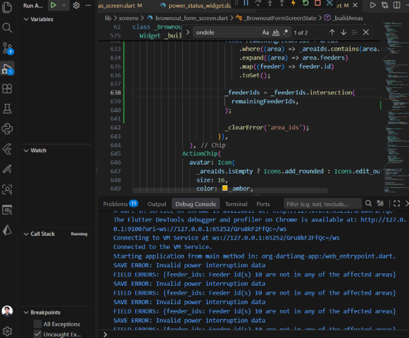
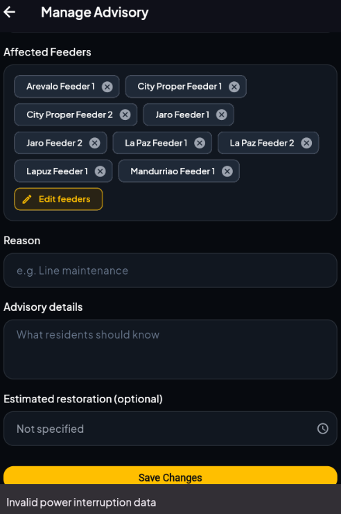
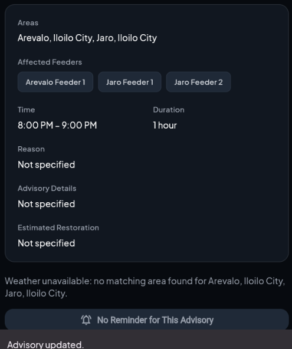

# Debugging Case: Stale Feeder Selections When Removing Affected Areas

**Component:** `lib/screens/brownout_form_screen.dart`  
**Feature:** Admin Portal — Edit Brownout Advisory  
**Status:** Fixed and retested  
**Debugging Method:** Application testing and debug output using VS Code's Run and Debug feature

## 1. Problem Description

When an administrator edited an existing brownout advisory and removed an affected area, saving the changes could fail with the error message **"Invalid power interruption data."**

The application was expected to allow administrators to remove affected areas and save the advisory, provided the remaining data satisfied the backend's validation rules.

## 2. How the Bug Was Found

The issue was discovered while testing the edit functionality in VS Code using the Run and Debug feature. After removing an affected area and attempting to save the advisory, the application's debug output displayed a validation error:

```text
SAVE ERROR: Invalid power interruption data
FIELD ERRORS: {feeder_ids: Feeder id(s) 10 are not in any of the affected areas}
```

The error indicated that feeder ID 10 was included in the submitted data even though it did not belong to any of the remaining affected areas.


## 3. Root Cause

The form maintained affected area IDs (_areaIds) and feeder IDs (_feederIds) separately. When an administrator removed an area using its delete icon, the area's ID was removed from _areaIds, but its associated feeder IDs were not removed from _feederIds.

Consequently, the form could submit stale feeder IDs that no longer corresponded to the selected areas. The backend rejected the request during validation.

## 4. Fix Implemented

The area's onDeleted callback in lib/screens/brownout_form_screen.dart was updated to recalculate the feeder IDs associated with the remaining selected areas and intersect them with the existing feeder selections.

This removes invalid feeder IDs associated with deleted areas while preserving valid feeder selections.

## 5. Testing and Verification

After implementing the fix, the brownout advisory was edited and saved successfully after an affected area was removed.

Result: The save operation succeeded, and the form no longer retained the stale feeder selection responsible for the validation error.

## 6. Evidence

### Figure 1. Debugging Output in VS Code

The debug output identifies feeder ID `10` as invalid because it does not belong to any of the remaining affected areas. This helped identify the cause of the failed save operation.



### Figure 2. Failed Save Before the Fix

The application displays "Invalid power interruption data" when saving the advisory after an affected area is removed.



### Figure 3. Successful Save After the Fix

After correcting the feeder selection logic, the application displays "Advisory updated" when the administrator saves the modified advisory successfully.


